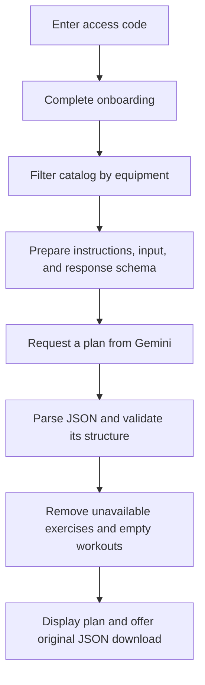

# Fitness App Prototype Technical Documentation

## 1. Architecture

The prototype generates a one-week workout plan for beginners or adults returning to exercise. Users select a fitness goal, available equipment, workouts per week, and session length. A Python Streamlit application filters a local exercise catalog and sends the selections and eligible exercises to Gemini through the `google-genai` SDK.



Streamlit provides both the interface and application logic. Local JSON and text files supply the onboarding configuration, exercise catalog, generation instructions, and output schema. Gemini is the external generation service; there is no separate application backend or database. Streamlit session state retains authorization, the prepared request, and the last successful result across interface reruns within a session.

The implemented flow includes access control, required onboarding selections, equipment filtering, AI generation, response validation, JSON display, and download. Feedback-based adjustment and exercise replacement remain planned features.

## 2. Setup and Usage

### Hosting your own copy

You need GitHub and Streamlit Community Cloud accounts, a Gemini API key, and a model identifier compatible with the app's Gemini request format.

1. Open the [project repository](https://github.com/titojones117/Fitness-App-CECS451), select **Code > Download ZIP**, and extract the archive.
2. Create a repository in your own GitHub account. Upload the extracted project contents so that `app.py`, `requirements.txt`, and the other core files are at the repository root, rather than inside an extra enclosing folder. Commit the uploaded files.
3. Sign in to [Streamlit Community Cloud](https://share.streamlit.io/) and connect your GitHub account.
4. Select **Create app** and choose the option to deploy an existing app. Select your repository and the branch containing the uploaded code. Set the entrypoint file to `app.py`.
5. Open **Advanced settings**. In **Secrets**, enter the following, replacing the placeholders with your own values:

```toml
PROJECT_ACCESS_CODE = "your-project-access-code"
GEMINI_API_KEY = "your-gemini-api-key"
GEMINI_MODEL = "your-compatible-gemini-model-id"
```

6. Save the settings and deploy the app. Community Cloud installs the dependencies from `requirements.txt` and provides a URL for your hosted copy.

Choose your own access code and configure all three settings, including `GEMINI_MODEL`. Enter credentials in Community Cloud's Secrets settings, not in the GitHub repository. You can update them later through the app's settings. This hosting route does not require a local Python installation.

See Streamlit's [deployment guide](https://docs.streamlit.io/deploy/streamlit-community-cloud/deploy-your-app/deploy) and [secrets configuration guide](https://docs.streamlit.io/deploy/streamlit-community-cloud/deploy-your-app/secrets-management) for platform details.

### Running the prototype

1. Open the project's main hosted project URL which is included in the report. It is not recommended to run our prototype by hosting it, we suggest using our URL.
2. Enter the access code supplied by our team in the report, or the code you configured for your own copy, and select **Unlock**.
3. Fill out all four onboarding fields: goal, equipment, workouts per week, and session length.
4. Select **Generate workout plan** and wait for the response.
5. Review the displayed selections and workout plan. Optionally select **Download Gemini response (.json)** to save the original response.

### Sample walkthrough

For a sample request, select **Improve general fitness**, **Bodyweight only**, **1** workout per week, and **30** minutes, then generate a plan. The app filters the catalog to nine bodyweight exercises and requests a plan from Gemini. Each returned workout contains a number, title, approximate duration, and exercises identified by catalog ID with sets and repetitions.

The following illustrates one exercise entry in the response format; it is not a captured live result:

```json
{"exercise_id": "bodyweight_squat", "sets": 2, "reps": 10}
```

Generated plans can differ between requests. Downloads and ordinary interface reruns reuse the stored result without initiating another generation request. If generation fails, the app displays an error and retains the last successful result, if one exists.

## 3. Code Explanation

### Core files

| File | Purpose |
| --- | --- |
| `app.py` | Implements the Streamlit interface, access-code check, onboarding, equipment filtering, Gemini requests, validation, session state, and result download. |
| `onboarding_config.json` | Defines the four required onboarding fields, their labels, and available choices. |
| `exercise_catalog.json` | Contains 17 exercises with IDs, names, muscle groups, equipment requirements, and a flag indicating whether repetitions are counted per side. |
| `gemini_instructions.txt` | Directs Gemini to generate a one-week plan using only eligible exercises, with rules for workout structure, exercise selection, sets, and repetitions. |
| `workout_response_schema.json` | Defines the required JSON fields and types, requires nonempty workout and exercise arrays, and disallows additional fields. |
| `requirements.txt` | Declares `streamlit`, `google-genai>=2.3.0`, and `jsonschema>=4.0`. |

### Main functions and AI workflow

`load_onboarding_config()` reads the form definition. `load_exercise_catalog()` reads the exercise list and checks the catalog's basic structure and equipment entries. `filter_eligible_exercises()` keeps exercises whose equipment requirements match the user's selection: nine for bodyweight only or all 17 when dumbbells are available.

`prepare_gemini_request()` combines the instructions, user selections, eligible exercise records, and response schema. `generate_workout_plan()` sends them through `client.interactions.create`, using the configured model and requesting JSON matching the schema.

The returned text is parsed as JSON and validated with `jsonschema`. The app then removes exercise IDs outside the eligible catalog and omits workouts left empty. A response with no usable workouts is rejected. Successful results are stored in session state for display. The download preserves Gemini's original response, so it can contain entries removed from the displayed plan.

Our team's technical contribution includes the onboarding interface, structured exercise catalog, equipment-selection logic, prompt and schema design, API integration, response handling, and download flow.

### Known limitations

Plans are displayed as JSON and stored only in session memory. Generation depends on API availability, model compatibility, and quota. The schema checks structure and types; requested workout count, numbering, positive sets/repetitions, and approximate duration are guided by the prompt rather than fully enforced by application validation. Duration is a requested label, not a calculated completion time. The prototype does not support gym machine equipment yet. 
